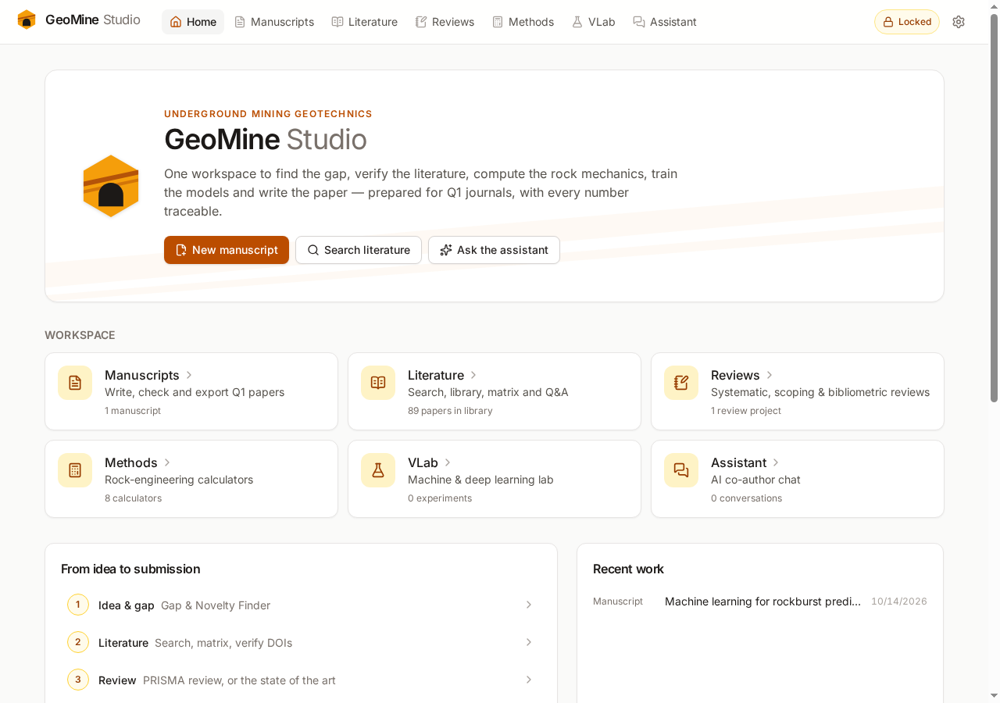
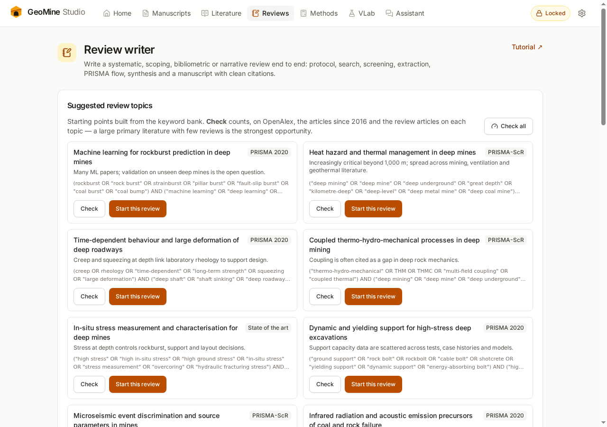

<p align="center"></p>

<h1 align="center">GeoMine Studio</h1>

<p align="center">
  <b>A research workspace for underground mining geotechnics — from research gap to Q1 submission.</b><br>
  Literature, systematic reviews, rock-engineering calculations, machine learning and manuscript writing in one place, with every number traceable.
</p>

<p align="center">
  <a href="https://dodyirawaan.github.io/geomine-studio/"><b>Open the app</b></a> ·
  <a href="docs/REVIEW.md">Review tutorial</a> ·
  <a href="docs/VLAB.md">Virtual Lab guide</a>
</p>

<p align="center">
  <a href="https://github.com/dodyirawaan/geomine-studio/actions/workflows/deploy.yml"></a>
</p>

<p align="center"></p>

---

## Why GeoMine Studio

Writing a Q1 paper in mining geotechnics means juggling literature databases, reference managers, spreadsheets, calculation tools, Python notebooks
and a word processor — and keeping every number, citation and claim consistent across them. GeoMine Studio brings that work into one browser-based
workspace built around three principles:

- **Domain expertise** — the AI co-author is instructed as a senior researcher in rock mechanics and mining: it reasons from mechanisms, checks values
  against typical ranges, applies ISRM/ASTM, PRISMA and journal conventions, and knows the field's key schools and terminology.
- **Integrity by design** — no invented data or references: missing data is marked `[DATA NEEDED]`, unverifiable claims `[VERIFY]`, references are
  checked against Crossref, and Methods text, PRISMA counts and statistics are generated from your data rather than by a language model.
- **Your data stay yours** — everything is stored in your browser; API keys are encrypted with your passphrase; optional sync goes to your own
  private GitHub repository, encrypted.

## Research focus

Rockburst and mining-induced seismicity · deep mining (high stress, heat, time-dependent behaviour) · ground support and tunnels ·
caving and stoping · water-conservation coal mining · backfill and CO₂ mineralisation · infrared-radiation and acoustic-emission monitoring ·
rock mass characterisation and numerical modelling · machine learning and deep learning in geomechanics.

Twenty target journals are profiled (Elsevier and Springer Nature), grouped by topic — from IJRMMS, TUST, RMRE, IJMST and JRMGE to Engineering
Geology, Underground Space, the International Journal of Coal Science & Technology, Journal of Cleaner Production and Computers and Geotechnics.

## Modules

| Module | What it does |
|---|---|
| **Manuscripts** | IMRaD and review templates per journal; section editor with an AI co-author (draft from notes, revise, polish, critique); citations as `[@key]`; four citation styles (Elsevier Harvard, APA 7, Springer, numbered); export to **Word** (native equations, three-line tables, line numbers) and **LaTeX** (`elsarticle` / `sn-jnl`). |
| **Workspace** | Idea → outline → draft → Reviewer 2 → revision with a response letter; rule-based **consistency check** (citations, placeholders, figure/table numbering, abbreviations, units, values missing from the main text); **Q1 checklist**; version history. |
| **Literature** | OpenAlex search, local library with PDFs (text extracted in the browser), **Crossref reference verification**, AI literature matrix, and questions answered from your own papers with page citations. |
| **Reviews** | **Systematic (PRISMA 2020), scoping (PRISMA-ScR), bibliometric and narrative reviews** end to end: keyword bank and suggested topics with a live review-gap indicator, protocol, multi-database search (OpenAlex + Scopus/Web of Science imports), AI-assisted screening with human decisions, extraction and quality appraisal, PRISMA diagram, bibliometrics, evidence statistics, two-stage thematic synthesis, publication-readiness check, and a finished manuscript. |
| **Methods** | RMR89, Q-system and support, GSI, Hoek–Brown with rock mass modulus and Mohr–Coulomb fit, Kirsch stresses with rockburst criteria, convergence–confinement, dynamic support demand and stability graph — each writes its own Methods paragraph with equations and verified references. |
| **VLab** | Machine and deep learning in the browser (scikit-learn, XGBoost, LightGBM, TensorFlow.js) with grouped/temporal leakage-safe validation, nested tuning, bootstrap confidence intervals, corrected t-tests, SHAP and permutation importance, and a detailed report with a reproducing Python script. |
| **Assistant** | Chat with nine expert modes (Research Assistant, Literature Analyst, Gap & Novelty Finder, Methods Writer, Results & Discussion, ML/DL Modelling, Review Methodologist, Reviewer 2, Language Polisher), with any of Anthropic Claude, OpenAI, Google Gemini or OpenRouter. |

<p align="center"></p>

## Getting started

1. Open **[the app](https://dodyirawaan.github.io/geomine-studio/)** — nothing to install. On desktop or mobile you can also install it as an app
   (browser menu → *Install*); writing, calculations and exports then work offline.
2. **Settings → create your key vault** with a passphrase, and add an API key for at least one AI provider (Claude, OpenAI, Gemini or OpenRouter).
   Use a key with a spending limit. Writing, calculators and exports work without any key.
3. Choose a default model from the provider's list.
4. Start where you are in your research:
   - a new paper → **Manuscripts → New manuscript**
   - a review → **Reviews** → pick a suggested topic or build a search string in the keyword bank
   - analysis → **Methods** or **VLab**

Optional: in Settings, add a free OpenAlex API key for more searches per day, and a fine-grained GitHub token to sync your work across devices.

## A typical workflow

1. **Find the gap** — Assistant (*Gap & Novelty Finder*) and the review-gap indicator in Reviews.
2. **Build the literature** — search, import PDFs, verify DOIs, extract a literature matrix.
3. **Compute and model** — Methods calculators and VLab experiments, each producing Methods and Results text with tables.
4. **Write** — section by section with the co-author, citing only papers in your library.
5. **Check** — consistency check, Reviewer 2 simulation, Crossref verification, Q1 checklist.
6. **Submit** — export to Word or the journal's LaTeX template in the journal's citation style.

## Documentation

- [Review tutorial](docs/REVIEW.md) — step-by-step guide to writing systematic, scoping, bibliometric and narrative reviews (in Indonesian).
- [Virtual Lab guide](docs/VLAB.md) — how experiments are split, trained, evaluated and reported, ready to cite in a Methods section.

## Privacy and security

GeoMine Studio is a static web application with no backend.

- Manuscripts, chats, the library, PDFs, experiments and reviews are stored in your browser (IndexedDB). Use **Settings → Backup** regularly.
- API keys are encrypted with AES-256-GCM using a key derived from your passphrase (PBKDF2, 310,000 iterations) and are sent only to their own provider.
- Requests leave your browser only to the AI provider you choose, to OpenAlex and Crossref (search terms, DOIs and reference titles), to the Python
  runtime CDN when the Virtual Lab first loads, and — if you enable sync — to your own private GitHub repository, encrypted by default.

## Responsible use of AI

The assistant drafts, critiques and organises; you remain the author. GeoMine Studio is built to make that easy to honour: AI suggestions in
screening are never applied without your decision, AI-drafted text is kept as proposals until you accept it, generated citations are limited to
your verified library, and manuscripts include the generative-AI declaration that Elsevier and Springer Nature require. Read, check and rewrite
every AI-generated passage before submission.

## Technology

React 19 · TypeScript · Vite · Tailwind CSS · Dexie (IndexedDB) · docx and JSZip (export) · pdf.js · Pyodide with scikit-learn, XGBoost and LightGBM ·
TensorFlow.js (WebAssembly backend) · KaTeX · OpenAlex and Crossref APIs · GitHub Pages and a service worker for offline use.

## Development

```bash
npm install
npm run dev      # http://localhost:5173/geomine-studio/
npm run lint
npm run build    # production build in dist/
```

Every push to `main` is linted, built and deployed to GitHub Pages by [`.github/workflows/deploy.yml`](.github/workflows/deploy.yml)
(set **Settings → Pages → Source** to *GitHub Actions* once).

```
src/
  ai/           providers, expert prompts, usage tracking
  manuscript/   templates, citation styles, Word / LaTeX / Markdown export
  literature/   OpenAlex, Crossref verification, PDF text, retrieval
  review/       review methods, search, PRISMA, evidence statistics, writing
  methods/      rock-engineering calculators
  vlab/         data preparation, splits, engines, metrics, reports
  pipeline/     consistency checks, Q1 checklist, snapshots
  sync/         encrypted GitHub sync and backups
  pages/        application screens
```

## Acknowledgements

Literature data from [OpenAlex](https://openalex.org) and [Crossref](https://www.crossref.org). Machine learning runs on
[Pyodide](https://pyodide.org), [scikit-learn](https://scikit-learn.org), [XGBoost](https://xgboost.ai), [LightGBM](https://lightgbm.readthedocs.io)
and [TensorFlow.js](https://www.tensorflow.org/js). Reporting follows PRISMA 2020 (Page et al., 2021) and PRISMA-ScR (Tricco et al., 2018).
